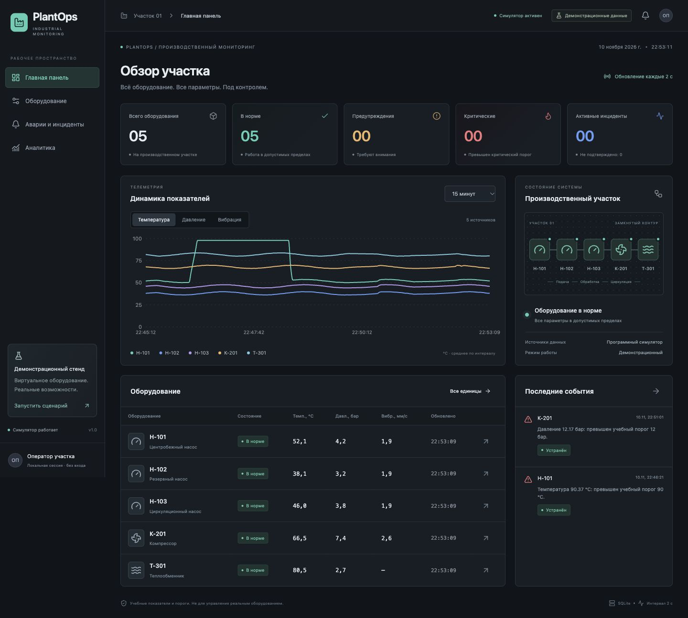
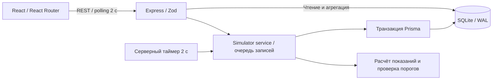

# PlantOps

**Industrial Equipment Monitoring System** — учебная система мониторинга промышленного оборудования. Полноценное локальное приложение с серверным симулятором, REST API, SQLite и интерфейсом оператора на русском языке.

> Все значения, пороги и аварии демонстрационные. PlantOps не подключается к реальному оборудованию и не предназначен для управления технологическим процессом.



## Возможности

- Пять единиц оборудования: Н-101, Н-102, Н-103, К-201, Т-301.
- Телеметрия температуры, давления и вибрации каждые 2 секунды.
- Обзор участка с KPI, схемой навигации по оборудованию, графиками и последними событиями.
- Реестр с поиском и фильтрацией; карточка оборудования с порогами, историей и управлением симуляцией.
- Независимые сценарии перегрева и превышения давления, которые можно запускать одновременно.
- Журнал с фильтрами, пагинацией, подтверждением и временными отметками.
- Автоматическое устранение инцидентов после восстановления нормальных параметров.
- Аналитика за 5 минут, 15 минут, час, 6 или 24 часа.
- Сохранение показаний, инцидентов, подтверждений и режимов симуляции после перезапуска.
- Тёмная адаптивная тема, состояния загрузки, пустых данных и ошибок подключения.

## Быстрый запуск

Нужны **Node.js 22.12+ (либо 24 LTS)** и **npm 10+**. Установка Node.js включает npm. Команды одинаковы в PowerShell, терминале macOS и Linux. Docker и облачные сервисы не нужны.

Клонируйте репозиторий и выполните команды из его корневой папки:

```sh
git clone https://github.com/Primetime26/plantops.git
cd plantops
npm ci
npm run setup
npm run dev
```

- Интерфейс: http://127.0.0.1:5173
- API: http://127.0.0.1:3001/api/health
- Остановка обоих процессов: `Ctrl+C`.

`setup` создаёт `apps/api/.env` из `.env.example`, генерирует Prisma Client, открывает файл SQLite, применяет миграции и выполняет seed. Повторный запуск **не сбрасывает** состояние и не добавляет дубликаты оборудования. Открытие файла до миграции устраняет ошибку Prisma 6 при работе с ещё не существующей SQLite-базой в некоторых окружениях.

При работе над зависимостями используйте `npm install`; для воспроизводимой установки из lock-файла — `npm ci`.

### Запуск готовой сборки

```sh
npm run build
npm start
```

Express раздаёт API и собранный frontend по одному адресу: http://127.0.0.1:3001. Прямое открытие `/equipment/H-101` и обновление страницы поддерживаются. Перед первым запуском также нужны `npm ci` и `npm run setup`.

### Настройки

`apps/api/.env`:

```dotenv
DATABASE_URL="file:./plantops.db"
PORT=3001
HOST=127.0.0.1
```

Путь SQLite относителен `apps/api/prisma/schema.prisma`; файл по умолчанию — `apps/api/prisma/plantops.db`. База, `.env`, зависимости и сборки исключены через `.gitignore`.

Dev-proxy Vite направляет `/api` на `127.0.0.1:3001`. При смене порта API измените и `apps/web/vite.config.ts`. По умолчанию сервер слушает только локальный интерфейс. В MVP нет авторизации, поэтому приложение рассчитано на локальную демонстрацию.

## Стек

| Слой        | Технологии                                                                  |
| ----------- | --------------------------------------------------------------------------- |
| Frontend    | React 19, TypeScript, Vite 8, React Router 7                                |
| Интерфейс   | Tailwind CSS 4, локальный компонент Button из shadcn/ui, Radix Slot, Lucide |
| Графики     | Recharts 3                                                                  |
| Backend     | Node.js, Express 5, TypeScript, Zod 4                                       |
| Данные      | Prisma ORM 6, SQLite, SQL-миграции                                          |
| Проверки    | Vitest 5, Supertest, TypeScript                                             |
| Репозиторий | npm workspaces, общий пакет контрактов API                                  |

Prisma 6 выбран для простого SQLite-подключения без дополнительного драйвера и адаптера. Для транзитивного `deepmerge-ts` зафиксирован override на исправленную ветку 8; совместимость проверяется миграциями, генерацией и API-тестами. Lock-файл включён в проект.

shadcn/ui использует модель локального владения исходниками: `components/ui/button.tsx`, `components.json`, `lib/utils.ts` и CSS-токены темы находятся в проекте. Остальные компоненты реализованы специально для мониторинга.

## Архитектура



Frontend отображает серверные данные; пороги, оценка состояния, переходы инцидентов и симуляция находятся на backend. Браузер не управляет временем симуляции. Закрытие вкладки не останавливает сбор данных.

### Структура проекта

```text
apps/
  api/
    prisma/
      schema.prisma
      migrations/                 # Версионируемая SQL-схема
      seed.ts
    scripts/prepare-db.ts         # Безопасное создание файла базы
    src/
      domain/                     # Диапазоны, генерация, оценка порогов
      repositories/               # Seed и запись показаний/инцидентов
      services/simulator.ts       # Таймер, очередь, fault/reset/ack
      routes/api.ts               # REST и Zod-валидация
      app.ts                      # Express и единый обработчик ошибок
      db.ts
      index.ts                    # Запуск и корректная остановка
    tests/api.test.ts             # Интеграционные тесты на SQLite
  web/
    src/
      components/ui/              # shadcn/ui Button
      components/                 # Графики, таблицы, статусы, KPI
      pages/                      # Обзор, реестр, карточка, журнал, аналитика
      lib/                        # API-клиент, polling, форматирование
      App.tsx
      index.css
packages/contracts/src/index.d.ts # Общие TypeScript-контракты
scripts/setup.mjs
.github/workflows/ci.yml
.env.example
package-lock.json
```

### Согласованность данных

Одна транзакция записывает показания, состояние оборудования и изменения его инцидентов. Все операции записи одного процесса проходят через очередь: таймер не пересекается с reset, fault и acknowledge. Дополнительно `Incident.activeKey` имеет уникальный индекс: `equipmentId:type` для незавершённого инцидента, `NULL` для устранённого. Это защищает от дублирования активных событий; история не ограничивается одним событием на оборудование.

Схема связей: `Equipment 1:N TelemetryReading`, `Equipment 1:N Incident`. История индексирована по оборудованию и времени. SQLite работает в WAL-режиме. Сервер следует запускать **одним процессом** — несколько симуляторов на одну базу не поддерживаются.

## Модель симуляции

В норме температура плавно колеблется около номинала (синусоидальная составляющая и небольшой шум), давление и вибрация — в собственных диапазонах. Скорость изменения ограничена. Теплообменник не имеет датчика вибрации (`null`). Н-102 в учебной модели работает на малой нагрузке; отдельный режим остановки не реализован.

| Оборудование | Температура: номинал / предупр. / крит., °C | Давление: номинал / предупр. / крит., бар | Вибрация: номинал / предупр. / крит., мм/с |
| ------------ | ------------------------------------------- | ----------------------------------------- | ------------------------------------------ |
| Н-101        | 52 / 75 / 90                                | 4.2 / 6 / 8                               | 1.8 / 4.5 / 7.1                            |
| Н-102        | 38 / 75 / 90                                | 3.2 / 6 / 8                               | 1.8 / 4.5 / 7.1                            |
| Н-103        | 46 / 75 / 90                                | 3.8 / 6 / 8                               | 1.8 / 4.5 / 7.1                            |
| К-201        | 68 / 90 / 105                               | 7.5 / 10 / 12                             | 2.4 / 5 / 8                                |
| Т-301        | 82 / 105 / 120                              | 2.8 / 4.5 / 6                             | —                                          |

При перегреве температура растёт до `critical + 8` с шагом не более 8 °C за цикл. Давление растёт до `critical + 1.2` с шагом не более 0.8 бар. Порог включительный: `>= warning` / `>= critical`. Статус оборудования определяется наихудшим из текущих параметров.

- `ACTIVE` → оператор подтверждает → `ACKNOWLEDGED`.
- Оба статуса считаются незавершёнными и входят в KPI активных инцидентов.
- Эскалация предупреждения до критического уровня сохраняет ID события, но возвращает его в `ACTIVE` и очищает прежнюю отметку подтверждения: оператор должен увидеть новый уровень.
- Reset сразу возвращает номинальные значения, записывает показание, снимает оба сценария и переводит связанные незавершённые инциденты в `RESOLVED`.
- Критичность в истории — максимальный уровень события. Снижение значения само по себе не переписывает историю критичности.
- Повторное подтверждение идемпотентно. Подтверждение устранённого события возвращает `409`.
- При перезапуске сохраняются флаги неисправностей и последние показатели. Первый цикл продолжает их; показания за время простоя не выдумываются.

## REST API

Все маршруты начинаются с `/api`. Время — ISO 8601 UTC; UI показывает локальное время браузера. ID в URL — латинские `H-101`, `H-102`, `H-103`, `K-201`, `T-301`; отображаемые имена — кириллические.

| Метод / маршрут                        | Назначение и параметры                                                                        |
| -------------------------------------- | --------------------------------------------------------------------------------------------- |
| `GET /equipment`                       | Массив; `search`, `status=NORMAL\|WARNING\|CRITICAL`                                          |
| `GET /equipment/:id`                   | Карточка, текущие показатели, режимы и пороги                                                 |
| `GET /equipment/:id/telemetry`         | `minutes=1..1440`, по умолчанию 15; `{items, from, to, bucketMs}`                             |
| `GET /incidents`                       | `equipmentId`, `status`, `severity`, `page`, `pageSize=1..100`; `{items,total,page,pageSize}` |
| `GET /incidents/:id`                   | Инцидент с оборудованием и временными отметками                                               |
| `PATCH /incidents/:id/acknowledge`     | Подтверждение, тело не требуется                                                              |
| `POST /simulation/equipment/:id/fault` | JSON `{"type":"OVERHEAT"}` или `{"type":"OVERPRESSURE"}`; `202`                               |
| `POST /simulation/equipment/:id/reset` | Возврат в норму, тело не требуется; `200`                                                     |
| `GET /dashboard/summary`               | KPI и состояние/последний цикл симулятора                                                     |
| `GET /analytics`                       | `minutes=1..1440`; события по оборудованию/критичности, число записей и устранений            |
| `GET /health`                          | Доступность SQLite и состояние симулятора                                                     |

История агрегируется в SQLite до примерно 301 точки на оборудование. Графики показывают **среднее внутри временного интервала**: при выборе длинного периода краткий пик может сглаживаться. Инциденты вычисляются по исходным показаниям, а не по средним значениям. При первом запуске есть только исходная точка; история накапливается во время работы сервера.

Аналитика инцидентов относится к событиям, **возникшим** в выбранном периоде. Устранённые — подмножество этих событий. Выбор оборудования на странице аналитики фильтрует графики телеметрии; сводные показатели и диаграммы инцидентов описывают весь участок и подписаны соответствующим образом.

### Формат ошибки

```json
{
  "error": {
    "code": "NOT_FOUND",
    "message": "Оборудование не найдено"
  }
}
```

`400` — некорректный JSON, ID, тело или параметры; `404` — объект/маршрут не найден; `409` — недопустимый переход статуса; `413` — тело больше 16 КБ; `500` — внутренняя ошибка без раскрытия стека. При ошибке Zod добавляется `error.details`. Неизвестные поля fault-запроса и query-параметры отклоняются.

## Демонстрация на собеседовании

1. Запустите приложение, дождитесь нескольких циклов и откройте главную панель: 5 единиц в норме.
2. Откройте **Н-101** → **«Симулировать перегрев»**.
3. За 6–12 секунд температура последовательно пересечёт 75 °C и 90 °C. Статус изменится на предупреждение, затем критический.
4. В журнале появится **один** инцидент. Несколько следующих циклов не создадут копии.
5. После достижения критического уровня нажмите **«Подтвердить»**. Оборудование останется неисправным, инцидент станет подтверждённым.
6. Обновите страницу: значения, режим и подтверждение сохранятся. Можно также остановить и заново запустить сервер.
7. В карточке нажмите **«Восстановить нормальный режим»**. Температура вернётся к номиналу; инцидент останется в истории с отметкой устранения.
8. Откройте аналитику: видны подъём/сброс температуры и зарегистрированный инцидент. Повторный перегрев создаст новое событие истории.

## Проверки

```sh
npm run typecheck
npm test
npm run build
npm audit
npm run format:check
```

Интеграционные тесты используют уникальную временную SQLite-базу и настоящую миграцию. Рабочая база не очищается. Таймер в тестах не запускается: сценарии детерминированно проходят заданное количество серверных циклов.

Покрываются список и идемпотентность seed, 404, пересечение порогов, эскалация одного события, отсутствие дублей, параллельные команды, подтверждение, reset, сохранение истории, два независимых дефекта, валидация, восстановление новым экземпляром сервиса, телеметрия, аналитика и нормальная работа без ложных аварий.

CI настроен на Windows, macOS и Linux с Node.js 22. Факт наличия конфигурации CI не означает, что удалённые запуски уже выполнены. Локальные результаты и ручная проверка описаны в [docs/VERIFICATION.md](docs/VERIFICATION.md).

## Ограничения MVP

- Учебная модель, не физическая модель оборудования. Нет OPC UA, Modbus, PLC, резервирования или реального управления.
- Один локальный сервер/оператор; нет пользователей, ролей и защищённого удалённого доступа.
- Polling раз в 2 секунды; сообщения об авариях отображаются в интерфейсе, без системных push/email/SMS.
- Reset намеренно мгновенный, физическое охлаждение не моделируется.
- История записывается без автоматической очистки: 216 000 строк в сутки для пяти единиц. Нужна политика хранения для длительной эксплуатации.
- UI запрашивает максимум последние 24 часа; долгосрочная агрегация не реализована.
- Последняя отметка подтверждения хранится в событии; отдельного аудита всех действий оператора нет.
- Нет отдельного сценария высокой вибрации, но пороги и создание событий по вибрации предусмотрены бизнес-логикой.
- Схема участка — навигационная иллюстрация, не инженерная P&ID.

## PlantOps 2.0

- Авторизация, роли оператора/инженера и неизменяемый аудит действий.
- WebSocket/SSE, подтверждение доставки и уведомления по правилам эскалации.
- Политика хранения, долгосрочные агрегаты и экспорт CSV/PDF.
- Настройка порогов, гистерезис, задержка срабатывания, обслуживание и простои.
- PostgreSQL для нескольких операторов; адаптеры OPC UA/Modbus отдельно от симулятора.
- Модели деградации, прогноз отказов и журнал регламентных работ.
