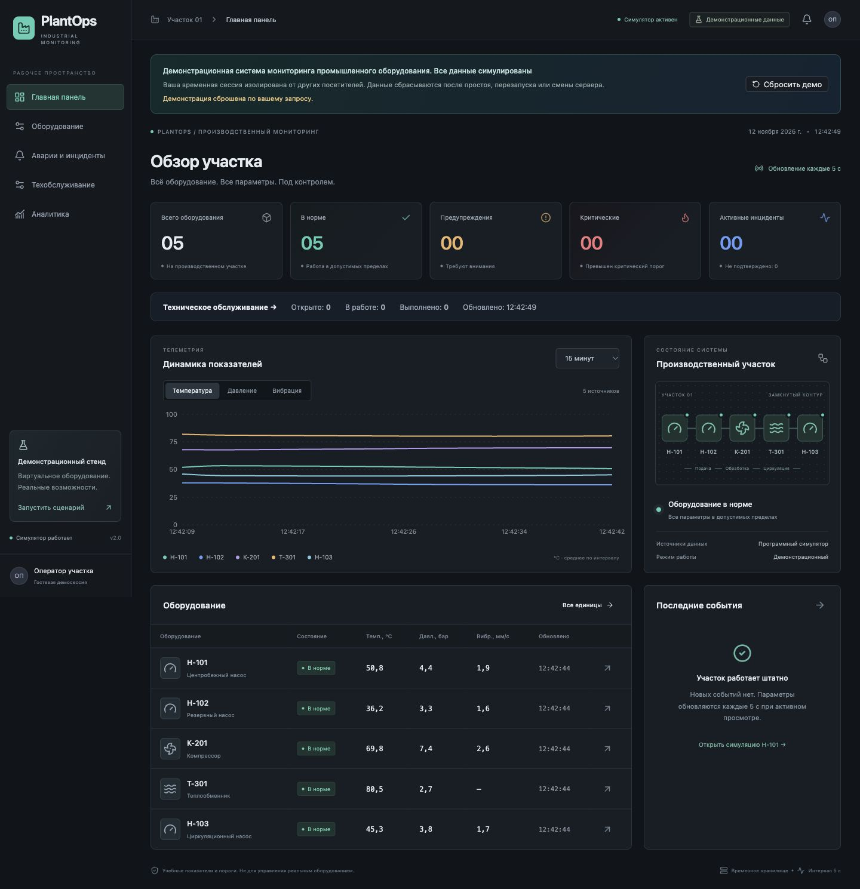
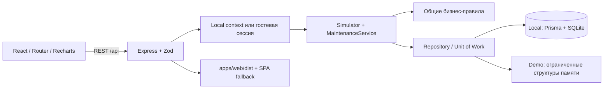
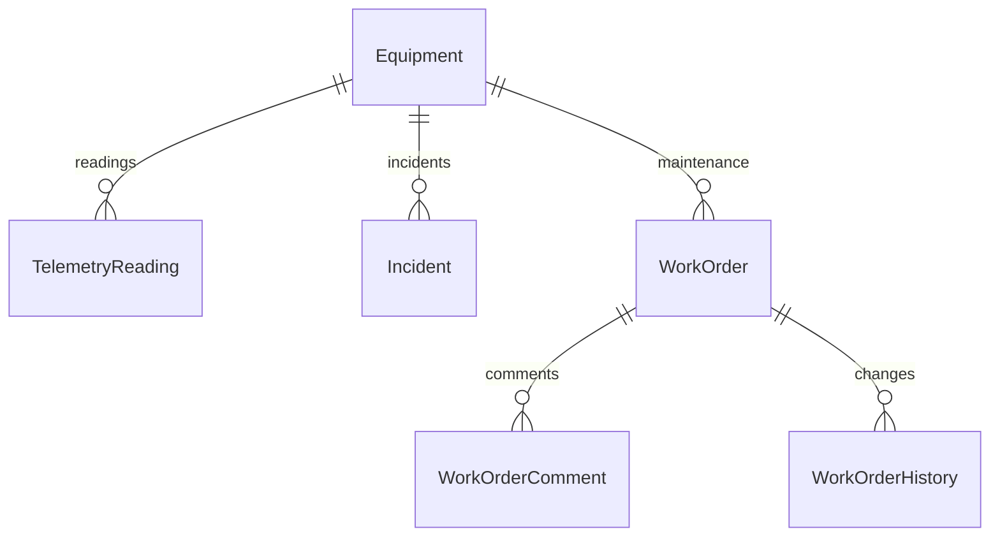

# PlantOps

**Industrial Equipment Monitoring & Maintenance System** — учебная система мониторинга и обслуживания промышленного оборудования. Реальные REST-операции, серверная симуляция, инциденты и заявки; русскоязычный интерфейс оператора.

> Демонстрационная система мониторинга промышленного оборудования. Все данные симулированы. Пороги учебные, подключений к реальным PLC/SCADA нет.

**Публичная демонстрация:** _добавьте HTTPS-адрес после самостоятельного размещения_. Проект подготовлен для Layero Free без обязательных платных сервисов; облачная публикация в ходе разработки не выполнялась.



_Скриншот локально запущенной production-сборки Public Demo. Дополнительные снимки оборудования и техобслуживания можно добавить после публикации; Playwright сохраняет их в `test-results`._

## Возможности

- Пять активов: Н-101, Н-102, Н-103, К-201, Т-301; поиск, состояния, карточки и учебные пороги.
- Температура, давление, вибрация; общая серверная модель для обоих режимов хранения.
- Перегрев, превышение давления, высокая вибрация и комбинированный сценарий.
- Инциденты с эскалацией, идемпотентным подтверждением, автоматическим устранением и историей без повторных активных записей.
- Заявки: оборудование, описание, приоритет, ответственный, комментарии, история, редактирование, закрытие, отмена, архивирование, поиск и фильтры.
- Dashboard с состоянием API, KPI, последними событиями, телеметрией и статистикой обслуживания.
- Аналитика за выбранный период, распределение по оборудованию, критичности и типу неисправности. CSV журнала и усреднённой телеметрии.
- Адаптивная тёмная тема, skeleton-загрузка, пустые состояния, ошибки, уведомления, подтверждения и формы с клавиатурной навигацией.
- В публичной версии: отдельное временное состояние посетителя, сброс демо, контролируемое восстановление после перезапуска сервера.

## Быстрый локальный запуск

Нужны Node.js **24** (рекомендуется, проверен) либо **22.12+** и npm 10+. Docker и облако не нужны. В корне проекта, одинаково в PowerShell/macOS/Linux:

```sh
npm ci
npm run setup
npm run dev
```

UI: `http://127.0.0.1:5173`, API: `http://127.0.0.1:3001/api/health`. Остановка — Ctrl+C.

`setup` создаёт `apps/api/.env`, только если файла ещё нет, генерирует Prisma Client, применяет миграции и seed. Повторный запуск сохраняет данные и не дублирует пять активов. SQLite по умолчанию находится в `apps/api/prisma/plantops.db`; `.env`, БД и зависимости исключены из Git.

Готовая локальная сборка на одном порту:

```sh
npm run build
npm start
```

Откройте `http://127.0.0.1:3001`. Локальная конфигурация использует `APP_MODE=local`, `HOST=127.0.0.1`, `DATABASE_URL="file:./plantops.db"`. При смене API-порта для разработки обновите dev-proxy в `apps/web/vite.config.ts`. Local Mode рассчитан на доверенную рабочую станцию: авторизации и прав пользователей здесь нет.

## Public Demo без базы данных

```sh
npm ci
npm run build:demo
npm run start:demo
```

Откройте `http://127.0.0.1:3001`. `setup`, SQLite, миграции и `DATABASE_URL` для этого режима не нужны. Скрипт запуска выставляет `APP_MODE=demo`; без `NODE_ENV=production` cookie допускает локальный HTTP. На Layero production-cookie защищена флагами Secure, HttpOnly, SameSite=Strict.

**Инструкция публикации:** [docs/DEPLOY_LAYERO_FREE.md](docs/DEPLOY_LAYERO_FREE.md). Корень репозитория → один `node_web` → Express + собранный React. Не нужно выбирать два отдельных проекта `api` и `web`.

| Свойство                 | Local                                  | Public Demo                                 |
| ------------------------ | -------------------------------------- | ------------------------------------------- |
| Хранилище                | Prisma / SQLite / WAL                  | Память процесса, по гостевой cookie         |
| Данные после перезапуска | Сохраняются                            | Начальные данные и явное уведомление        |
| Симуляция                | Серверный таймер 2 с                   | Расчёт по запросу, шаг 5 с                  |
| Полный сброс             | Недоступен через API                   | Только собственная гостевая сессия          |
| Изоляция                 | Один локальный участок                 | До 10 независимых сессий                    |
| Телеметрия               | Накопление в SQLite                    | 360 последних точек на единицу              |
| Инциденты                | Сохраняются                            | До 100, вытеснение старых устранённых       |
| Заявки                   | До 1000                                | До 20, включая архив                        |
| Комментарии / история    | До 30 комментариев, постоянная история | До 10 комментариев / 40 последних изменений |
| Срок сессии              | Не ограничен                           | 15 минут без запросов / максимум 1 час      |

Cookie обозначает временную копию стенда, **не полноценную аутентификацию**. Вкладки одного профиля используют одну сессию. Удаление cookie, смена pod и перезапуск обнуляют демоданные. Распределённая согласованность между несколькими процессами без внешнего хранилища не обещается.

## Стек и структура

React 19, TypeScript, Vite 8, React Router 7, Tailwind 4, Lucide, Recharts 3; локальный Button по модели shadcn/ui (Radix Slot). Express 5, Zod 4, Prisma 6, SQLite. Vitest 5, Supertest, Playwright, GitHub Actions. Версии разрешены в `package-lock.json`.

```text
apps/
  api/
    prisma/               # схема, миграции, seed
    src/
      domain/             # модель, чистые функции симуляции, Zod
      storage/            # Repository, Prisma и memory адаптеры
      repositories/       # согласованное обновление телеметрии/инцидентов
      services/           # симулятор, заявки, сессии, CSV
      routes/             # REST и выборки
      app.ts              # middleware, защита, ошибки, SPA
      index.ts            # конфигурация и жизненный цикл процесса
    tests/                # unit + SQLite API + demo API
  web/src/
    components/           # графики, таблицы, UI, SessionGate
    pages/                # dashboard, equipment, incidents, maintenance, analytics
    lib/                  # API, polling, восстановление сессии
packages/contracts/       # общие TypeScript DTO
scripts/                  # setup, demo launcher, ресурсная проверка
e2e/                      # реальные браузерные сценарии
.github/workflows/        # CI без деплоя
docs/                     # аудит, QA, проверка, бесплатное размещение
layero.json               # единый production runtime
```

## Архитектура



Frontend не принимает бизнес-решений. Обновление оборудования, телеметрии и инцидентов проходит в одной транзакции. Записи сериализованы в адаптере; SQLite дополнительно защищает открытый инцидент уникальным `activeKey`. Memory-транзакция использует новые контейнеры коллекций и копии изменяемых записей; при ошибке черновик отбрасывается. Чтение возвращает отделённые значения.

Для заявки требуется `version`: конкурирующие правки с одинаковой версией дают один успех и один `409 VERSION_CONFLICT`, исключая тихую потерю изменений. История и комментарии сохраняются вместе с заявкой. Архивирование скрывает только закрытые заявки и сохраняет аудит.

Prisma импортируется динамически **только при `APP_MODE=local`**. Общая доменная модель не зависит от ORM. В demo нет фонового таймера, внешней очереди и искусственных запросов против засыпания сервера.

## Данные и бизнес-правила



- `Equipment`: ID, тип, местоположение, показатели, номиналы/пороги, флаги неисправностей, состояние и дата обновления.
- `TelemetryReading`: оборудование, timestamp, температура/давление/вибрация; индекс оборудования и времени.
- `Incident`: тип, максимальная достигнутая критичность, статус, описание, даты возникновения/подтверждения/устранения. Nullable unique `activeKey` освобождается при устранении.
- `WorkOrder`: оборудование, описание, приоритет, ответственный, статус, результат работ, версия, даты и признак архива. Комментарии и история связаны внешними ключами.

Состояния оборудования: `NORMAL`, `WARNING`, `CRITICAL`; порог срабатывает при **≥**. Общий статус соответствует наиболее серьёзному параметру. У Т-301 нет датчика вибрации: отдельная вибрационная неисправность возвращает 422.

Номинальный режим — ограниченные плавные синусоидальные колебания; функция зависит от времени, оборудования и внедряемого источника случайности (по умолчанию фиксированного). При перегреве температура растёт до `critical + 8` с шагом до 8 °C; давление до `critical + 1.2` с шагом до 0.8 бар; вибрация до `critical + 1` с шагом до 1.4 мм/с. Это учебная модель, не физический цифровой двойник.

`ACTIVE → ACKNOWLEDGED` означает получение сообщения. Сброс оборудования восстанавливает номиналы и переводит соответствующие события в `RESOLVED`. Повторное подтверждение идемпотентно; подтверждение устранённого события запрещено. Эскалация WARNING → CRITICAL сохраняет ID и требует нового подтверждения. Повторный отказ после устранения создаёт новый инцидент.

Заявки: `OPEN → IN_PROGRESS → COMPLETED`; отмена доступна из OPEN/IN_PROGRESS. Выполнение требует нормального оборудования и описания результата от 5 символов; отмена требует причину. Терминальные заявки неизменяемы; удалить через API можно только в архив. Заявка сама по себе не устраняет неисправность и не подтверждает инцидент.

В demo по запросу рассчитывается не более 12 пропущенных шагов. Длительная пауза не порождает тысячи фиктивных записей. График усредняет показания максимум примерно в 301 точку; краткий пик может сгладиться, но инцидент рассчитывается по исходному значению. Аналитика учитывает события, **возникшие** за выбранный период. Выбор оборудования фильтрует графики; показатели участка подписаны отдельно, CSV телеметрии выгружает весь участок за период.

## REST API

Префикс `/api`. Даты ISO 8601 UTC, UI отображает локальное время. В demo сначала `GET /session`, далее та же cookie. Для записей JSON и `X-PlantOps-Request: 1`, в том числе `{}` для reset/acknowledge.

| Метод и путь                           | Назначение                                                             |
| -------------------------------------- | ---------------------------------------------------------------------- |
| `GET /health`                          | Health без сессии; в Local также проверка БД                           |
| `GET /session`                         | Режим, ревизия, лимиты, гостевая cookie                                |
| `POST /demo/reset`                     | Сброс собственной demo-сессии; Local → 403                             |
| `GET /equipment`                       | Реестр; `search`, `status`                                             |
| `GET /equipment/:id`                   | Карточка                                                               |
| `GET /equipment/:id/telemetry`         | `minutes=1..1440`                                                      |
| `GET /telemetry`                       | История всех пяти активов одним запросом                               |
| `POST /simulation/equipment/:id/fault` | `type`: OVERHEAT / OVERPRESSURE / HIGH_VIBRATION / COMBINED, ответ 202 |
| `POST /simulation/equipment/:id/reset` | Восстановление номинальных параметров                                  |
| `GET /incidents`                       | `equipmentId`, `status`, `severity`, `page`, `pageSize`                |
| `GET /incidents/:id`                   | Событие                                                                |
| `PATCH /incidents/:id/acknowledge`     | Подтверждение                                                          |
| `GET /incidents/export`                | CSV по фильтрам, максимум 10 000 событий                               |
| `GET /dashboard/summary`               | Оборудование, инциденты, заявки, состояние симулятора                  |
| `GET /analytics`                       | `minutes`; статистика из реальных записей хранилища                    |
| `GET /analytics/export`                | CSV агрегированной телеметрии всего участка                            |
| `GET /maintenance`                     | `search`, `equipmentId`, `priority`, `status`, пагинация               |
| `POST /maintenance`                    | Создание заявки, 201                                                   |
| `GET /maintenance/:id`                 | Заявка с комментариями и историей                                      |
| `PATCH /maintenance/:id`               | Изменение и переход статуса с `version`                                |
| `POST /maintenance/:id/comments`       | Комментарий с `version`, 201                                           |
| `DELETE /maintenance/:id`              | Архив закрытой заявки с `version`, 204                                 |

Пагинация: `{items,total,page,pageSize}`, размер 1..100. Реестр заявок возвращает сокращённые записи без содержимого comments/history; полная история — в карточке.

Ошибки единообразны: `{"error":{"code":"NOT_FOUND","message":"Оборудование не найдено"}}`. 400 — Zod/JSON, 403 — запрет операции, 404 — отсутствует объект, 409 — конфликт/переход/сброс сессии, 413 — тело >16 КБ, 415 — не JSON, 422 — бизнес-условие, 429 — частота запросов, 503 — заполненный стенд. Подробнее: [API_TESTING.md](docs/qa/API_TESTING.md).

## Безопасность публичного стенда

Случайный 256-битный opaque ID находится в HttpOnly cookie, сервер не принимает клиентский выбор чужого состояния. Нет общего «администратора» и публичных паролей. Знание украденной cookie всё же даёт доступ к этой временной сессии — это не система учётных записей.

Zod ограничивает типы, длины и поля. Изменения требуют same-origin JSON-запрос с собственным заголовком; cross-site записи блокируются, CORS не включён. React экранирует текст, HTML пользователя не вставляется. CSP запрещает внешние скрипты, iframe и inline-script; CSV нейтрализует формулы и корректно экранирует значения.

В минуту: 240 запросов на адрес, 30 запросов создания/получения сессии на адрес, 30 изменений на сессию, 3000 API-запросов на процесс. Счётчики ограничены 1024 ключами. Health не требует сессии и исключён из rate limit. Защита рассчитана на демонстрационный стенд, не заменяет защиту инфраструктуры от DDoS.

## Проверки и воспроизводимость

```sh
npm run typecheck
npm test
npm run build:demo
npm run check:resources
npx playwright install chromium
npm run test:e2e
npm run format:check
```

- Unit: границы, номиналы, детерминизм, датчики, переходы, валидация и CSV.
- API: настоящая временная SQLite с миграциями и независимый memory-адаптер; конкуренция, rollback, сохранение, лимиты, сессии и бизнес-правила.
- E2E: четыре сценария Chromium, включая цикл оператора, два посетителя, планшет, холодную загрузку и настоящий перезапуск процесса. Используют production build, порты 3100/3101, не внешние услуги.
- Ресурсы: максимальное заполнение demo, конкурентные ответы, контроль RSS и запрет загрузки Prisma; для измерителя нужен Node 22.15+ или 24.

[Фактически выполненные проверки](docs/VERIFICATION.md) отделены от наличия тестов. Рабочая БД не очищается. GitHub Actions использует один Ubuntu runner, отменяет устаревшие прогоны, хранит артефакты ошибок 7 дней и ничего не публикует. Использование ограничивается условиями вашего GitHub-аккаунта; remote CI не считается выполненным до первого запуска.

## Сценарий демонстрации

1. Откройте Dashboard: пять активов и обновляющиеся графики.
2. Н-101 → перегрев. В demo примерно за 15–30 секунд активного просмотра появится критическое состояние и один инцидент температуры; локально это быстрее.
3. Подтвердите критический инцидент. Убедитесь, что насос остаётся неисправным.
4. Создайте заявку, назначьте «Сервисная бригада», добавьте комментарий, возьмите в работу.
5. Попытайтесь завершить заявку при неисправном насосе — сервер отклонит действие.
6. Восстановите нормальный режим. Инцидент останется в истории как устранённый.
7. Укажите результат и завершите заявку. Просмотрите историю и CSV аналитики.
8. В demo сбросьте свою сессию; в Local перезапустите сервер и проверьте сохранение.

## Документация QA

- [План тестирования](docs/qa/TEST_PLAN.md)
- [Тест-кейсы и трассировка](docs/qa/TEST_CASES.md)
- [Приёмочный чек-лист](docs/qa/CHECKLIST.md)
- [Примеры API](docs/qa/API_TESTING.md)
- [Шаблон дефекта и реальные исправления](docs/qa/BUG_REPORT_TEMPLATE.md)
- [Исходный аудит](docs/AUDIT.md)
- [Размещение на Layero Free](docs/DEPLOY_LAYERO_FREE.md)

## Ограничения и развитие

Нет реальной промышленной связи, ролей, SLA, гарантированной круглосуточной доступности или сохранности публичных демоданных. Первый HTML при холодном старте зависит от Layero. Ограничения тарифа надо сверять перед публикацией. Local SQLite накапливает историю без автоматической очистки (до 216 000 показаний в сутки); период UI ограничен 24 часами. Длительная эксплуатация требует retention и серверных агрегатов. Reset оборудования мгновенный, схема участка иллюстративная, все пять активов считаются работающими.

Дальнейшее развитие: локально тестируемые роли с реальными проверками; гистерезис и задержки аварий; регламентное обслуживание и планировщик; retention и агрегаты; контракты OpenAPI; расширение доступности и браузерной матрицы. Постоянный многопользовательский облачный сервис — отдельный режим со своими требованиями, а не обязательное условие бесплатного портфолио.
