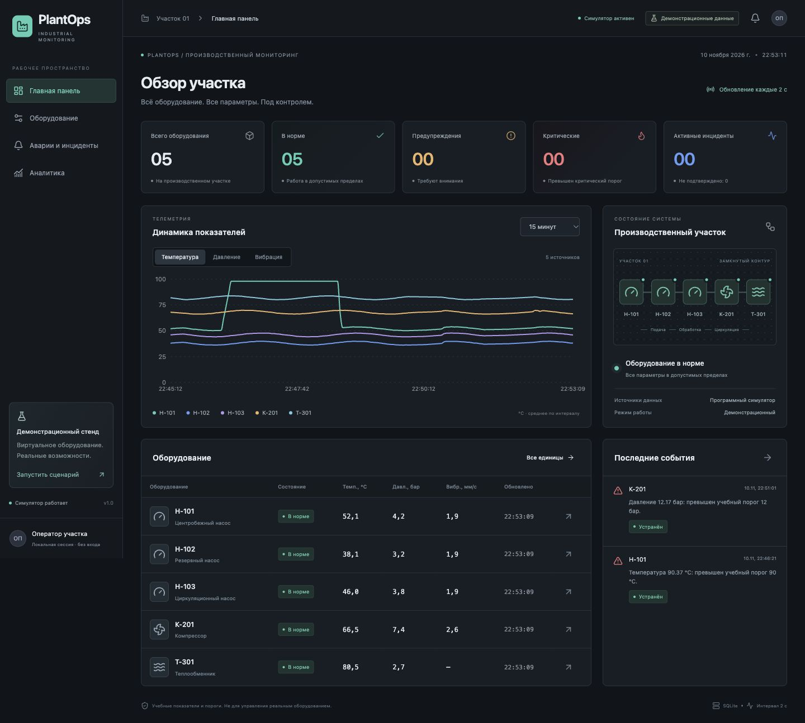

# Проверка PlantOps

Дата: 10 ноября 2026 года. Локальное окружение: macOS ARM64, Node.js 24.22.1, npm 10.9.2.

## Автоматические проверки

| Проверка                           | Результат                                                        |
| ---------------------------------- | ---------------------------------------------------------------- |
| Установка в чистой копии: `npm ci` | Успешно, lock-файл воспроизводим                                 |
| `npm run setup` в чистой копии     | Созданы .env и SQLite; применена миграция; 5 единиц оборудования |
| Повторные migrate/seed             | Без сброса состояния и дубликатов                                |
| `npm run typecheck`                | Frontend и backend без ошибок                                    |
| `npm test`                         | 9 интеграционных тестов прошли                                   |
| `npm run build`                    | Frontend и backend собраны, без предупреждения о размере чанков  |
| `npm audit`                        | 0 известных уязвимостей на момент проверки                       |
| `npm run format:check`             | Исходники соответствуют Prettier                                 |

В чистой копии отсутствовали node_modules, .env, SQLite-файл и каталоги dist. Установка, setup, типизация, тесты и сборка выполнены заново. Тесты используют временную базу, создаваемую настоящей миграцией, и не изменяют рабочие данные.

## Проверка в браузере

Проверены development-режим и production-сборка, которую Express раздаёт вместе с API. Основные размеры: 1440 × 1000 и 834 × 1112; также просмотрена узкая панель предпросмотра.

1. Главная панель показывает пять единиц; показания и время обновляются автоматически.
2. Графики используют накопленную серверную телеметрию, включая зарегистрированный перегрев и сброс.
3. Перегрев Н-101 достиг 98 °C; за многократные циклы создан один инцидент.
4. Подтверждение оставило оборудование критическим; статус стал ACKNOWLEDGED.
5. Обновление страницы сохранило режим неисправности и время подтверждения.
6. Reset вернул насос к нормальным значениям; событие стало RESOLVED с сохранением обеих временных отметок.
7. Фильтр ACTIVE после восстановления показал пустой журнал.
8. Поиск «К-201» показал одну единицу из пяти.
9. Сценарий превышения давления компрессора достиг 13,2 бар и создал один связанный инцидент.
10. Сервер полностью остановлен и заново запущен: сохранились флаг неисправности, показатели и ID активного события.
11. При остановке API интерфейс сохранил последние данные и сообщил об ошибке; после запуска снова обновлялся. Текст сетевой ошибки локализован на русский.
12. После восстановления компрессора все пять единиц в норме, активных инцидентов нет, два события остались в истории.
13. Аналитика отображает реальные тренды, столбчатую диаграмму по оборудованию и распределение критичности.
14. Планшетная навигация, поиск и кнопки симуляции работают; таблицы прокручиваются внутри панелей.
15. Production deep link `/equipment/H-101` возвращает HTML с HTTP 200; API health отвечает HTTP 200.

Во время проверки основного сценария ошибок и предупреждений JavaScript в консоли не обнаружено. Ожидаемые ошибки сети при намеренной остановке API не считаются дефектом.

## Границы проверки

- Windows и Linux локально не запускались. Для них добавлена матрица GitHub Actions; удалённый CI ещё не выполнялся.
- Нет автоматических браузерных E2E-тестов; браузерный сценарий пройден вручную через инструменты управления UI.
- Длительный нагрузочный прогон и многопользовательская работа не проверялись; это локальный однопроцессный MVP.
- Производственные процессы проверки остановлены после завершения. Для просмотра запустите приложение по README.
